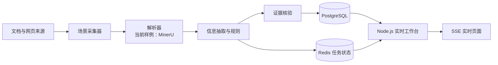

# LongShu

**LongShu 是面向多类业务场景的本地化信息提取与证据追溯平台。** 它把文档与网页等来源接入可复核的处理流程，产出带来源和证据的结构化信息，并提供实时运行观察能力。

当前仓库包含一条可运行的 **SEC 财报分析样例**。SEC 是首个验证场景，不是 LongShu 的产品边界。招投标文件分析等新场景仍需在后续工作中实现，不能把规划中的能力当作已交付功能。

## 设计目标

- **证据可回溯**：抽取结果应关联原始来源、页码或定位信息及证据片段，便于人工核对。
- **处理链可替换**：采集、解析、抽取、核验、入库和展示应逐步形成清晰接口，具体实现可按场景替换。当前代码仍以 SEC 样例为主，通用接口层尚未完整抽象。
- **过程可观察**：任务状态和新增产出可以实时展示；工作台也展示 CPU、内存与 GPU 使用信息。
- **本机数据优先**：模型、原始文件、解析结果、数据库卷和缓存保留在本机，不进入源码仓库。

## 能力分层

LongShu 将逐步把可复用的处理与追溯机制沉淀为**基础能力**，再通过 **Extended Abilities（扩展能力）** 接入不同来源、解析器和业务规则。例如，CDP 浏览器采集、MinerU 文档解析、采购文件条款识别都可以是可替换的扩展实现。当前代码已有 SEC 场景的部分处理组件，但通用能力契约和扩展注册机制尚未完整实现。

## 当前实现

| 部分 | 当前状态 |
|---|---|
| 文档解析 | MinerU 4.0.9 GPU 容器配置，申请 RTX 4070 的 GPU 0 |
| 存储与任务状态 | PostgreSQL、Redis，以及独立的 pgvector PostgreSQL 开发服务 |
| 信息提取样例 | Intel 与 Corning SEC 财报处理流水线，输出页级证据、结构化信息和报告 |
| 实时工作台 | Node.js 服务，通过 PostgreSQL `LISTEN/NOTIFY` 与 SSE 展示任务和产出，并显示主机资源状态 |
| 通用能力接口 | 目标方向已明确；采集、解析、核验、入库等跨场景接口仍需逐步从现有样例中抽象 |
| 招投标“废标死穴 / 控标参数”分析 | 产品方向；当前仓库尚未实现完整识别与判断流程 |

## 架构方向



图中展示的是 LongShu 的目标分层。仓库当前已有 SEC 样例、MinerU、PostgreSQL、Redis 和工作台；通用采集与证据核验接口仍在演进。

## 本机目录

本机项目根目录为 `E:\LongShu`。Docker Desktop 的 WSL 数据目录配置在 `E:\LongShu\Docker\DockerDesktopWSL`；镜像、容器层和数据卷应留在该 E 盘数据盘中。

| 路径 | 用途 | 是否提交 |
|---|---|---|
| `Projects/` | 应用源码与当前 SEC 样例 | 源码、锁文件和通用配置可提交 |
| `Docker/` | Compose、Dockerfile、数据库初始化 SQL 与示例配置 | 配置可提交；密钥和运行数据不提交 |
| `Data/` | 原始文件、解析结果、报告及业务数据 | 否 |
| `Models/`、`Cache/` | 模型权重、依赖与下载缓存 | 否 |
| `Docker/DockerDesktopWSL/`、`WSL/` | Docker / WSL 虚拟磁盘及运行数据 | 否 |
| `Logs/`、`Tools/`、`DockerShare/` | 本机日志、安装工具及共享数据 | 否 |

## 手动启动

基础服务不会配置为 Windows 开机自启。Docker Desktop 的自动启动已关闭；Compose 服务不使用自动重启策略。请通过 LongShu 脚本手动启动与停止。

### 1. 配置服务密码

首次使用时，在 PowerShell 中从项目根目录执行：

```powershell
Copy-Item Docker/mineru-stack/.env.example Docker/mineru-stack/.env
Copy-Item Docker/nagarjuna-pgvector/.env.example Docker/nagarjuna-pgvector/.env
```

编辑两个 `.env` 文件并替换示例密码。不要提交 `.env`。

### 2. 启动基础服务

```powershell
./start-services.ps1
```

也可以双击 `start-services.bat`。脚本会在 Docker Engine 未运行时手动打开 Docker Desktop，然后启动 MinerU GPU、PostgreSQL、Redis 和 pgvector PostgreSQL。首次启动 MinerU 镜像可能需要较长时间下载与构建。

### 3. 启动 Node.js 实时工作台

```powershell
./start-nodejs.ps1
```

访问 <http://127.0.0.1:8090>。也可以双击 `start-nodejs.bat`。工作台由 Node.js 22 或更高版本运行；依赖与 npm 缓存放在 `E:\LongShu` 下。

### 4. 停止或重启

```powershell
./stop-nodejs.ps1
./restart-nodejs.ps1
./stop-services.ps1
```

也有对应的 `.bat` 文件可双击运行。停止基础服务会停止容器并保留数据库卷；不会删除数据。停止 Node.js 工作台不会停止 Docker 服务，反之亦然。需要再次使用时，重新运行对应启动脚本。

## 当前 SEC 样例

准备本机输入清单 `Projects/sec-filings-intel-glw/filings.json` 和 SEC 原始文件后，可独立运行：

```powershell
python Projects/sec-filings-intel-glw/run_pipeline.py
```

原始文件与解析产物位于 `Data/Finance/SEC/`。该批处理不会随 Docker 或 Node.js 工作台自动运行。详细格式见 [`Projects/sec-filings-intel-glw/README.md`](Projects/sec-filings-intel-glw/README.md)；工作台运行说明见 [`Projects/sec-filings-intel-glw/dashboard/README.md`](Projects/sec-filings-intel-glw/dashboard/README.md)。

## 服务地址

| 服务 | 本机地址 |
|---|---|
| 实时工作台 | <http://127.0.0.1:8090> |
| MinerU API | <http://127.0.0.1:8000> |
| MinerU API 文档 | <http://127.0.0.1:8000/docs> |
| MinerU WebUI | <http://127.0.0.1:7860> |
| MinerU PostgreSQL | `127.0.0.1:5432` |
| Redis | `127.0.0.1:6379` |
| pgvector PostgreSQL | `127.0.0.1:5433` |

GPU 分配在 [`Docker/mineru-stack/compose.yaml`](Docker/mineru-stack/compose.yaml) 中声明。MinerU API 容器使用 NVIDIA GPU 0；需要已配置可供 Docker 使用的 NVIDIA GPU 环境。

## 安全与 GitHub 提交

- 不提交 `.env`、密码、API 密钥、令牌或个人凭据；只提交 `.env.example`。
- 不提交 `Data/` 下的文件、数据库导出、报告或 SEC 原件。
- 不提交模型权重、缓存、日志、`node_modules`、容器卷或 `.vhdx` 虚拟磁盘。
- 提交前检查 `git status --short` 和暂存清单，确认仅包含源码、通用配置和文档。

更多目录边界见 [`docs/repository-layout.md`](docs/repository-layout.md)。跨智能体协作说明见根目录 [`AGENT.MD`](AGENT.MD)；`AGENTS.md`、`GEMINI.md` 与 Cursor 规则提供相应入口。
